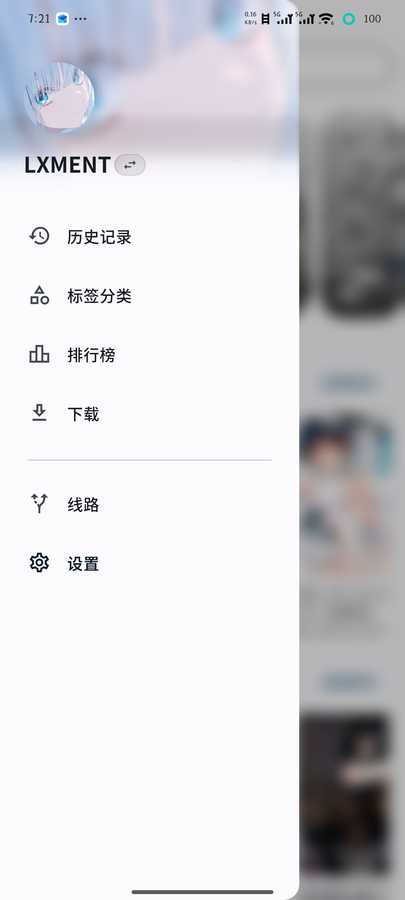

  
  
  
  

## 下载

前往 [Releases](https://github.com/LuckyLxi/Hazuki/releases) 下载最新 APK。

## 致谢

- [Venera](https://github.com/venera-app/venera) — 参考了部分实现
- [venera-configs](https://github.com/venera-app/venera-configs) — 使用了漫画源脚本
- [Animeko](https://github.com/open-ani/animeko) — 参考了部分 UI 设计

## 许可证

[GPL-3.0](LICENSE)

## 漫画源插件

新安装的应用不附带漫画源。在“设置 → 实验室 → 漫画源插件”导入本地 JS，或添加公开 GitHub 仓库。仓库使用 `plugins.json` 列出插件名字、版本和 JS 下载链接；用户选择后才下载对应插件。

插件 API、JS 类型声明、三个迁移源和打包工具见 [插件开发文档](docs/source_plugins.md)。升级保留旧账号、收藏、进度和下载数据，重新导入相同 ID 的插件后恢复关联。
