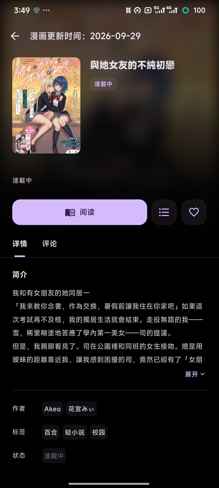
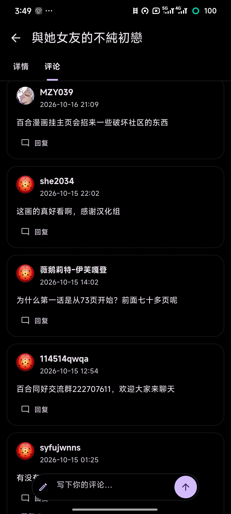

## 界面预览

<table>
  <tr>
    <th>首页</th>
    <th>漫画详情</th>
    <th>评论</th>
    <th>收藏</th>
  </tr>
  <tr>
    <td></td>
    <td></td>
    <td></td>
    <td></td>
  </tr>
</table>

## 下载

前往 [GitHub Releases](https://github.com/LuckyLxi/Hazuki/releases) 下载 Android APK。

## 本地开发

环境要求：Flutter `>=3.47.0`、Dart `^3.11.1`、`JDK 21`

```sh
flutter pub get
flutter gen-l10n
flutter run
flutter build apk --debug
```

## 致谢

- [Venera](https://github.com/venera-app/venera) — 参考了部分实现。
- [venera-configs](https://github.com/venera-app/venera-configs) — 使用了漫画源脚本。
- [Animeko](https://github.com/open-ani/animeko) — 参考了部分 UI 设计。

## 许可证

本项目采用 [GPL-3.0](LICENSE) 许可证。
